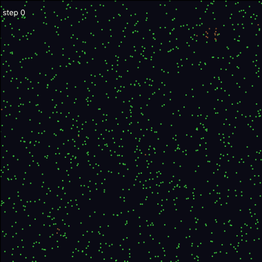

# PPS: Primordial Particle System

A fast C++ implementation of the **Primordial Particle System**, in which cell-like structures emerge, grow and reproduce from a one-line motion law for self-propelled particles:

> T. Schmickl, M. Stefanec, K. Crailsheim, *How a life-like system emerges from a simple particle motion law*, Sci. Rep. **6**, 37969 (2016), [doi:10.1038/srep37969](https://doi.org/10.1038/srep37969)



*120 × 120 world, density 0.08, paper parameters, 3,000 steps (`--size 120x120 --seed 4`). Green particles start out spread randomly and settle into a lattice; dense blue structures nucleate, grow and form rings.*

## The motion law

Each particle has a position $p_t$ and a heading $\phi_t$. In every step it counts the other particles within radius $r$ on its left ($L$) and right ($R$), with $N = L + R$. It then turns **right** by

$$
\Delta\phi = \alpha + \beta \cdot N \cdot \operatorname{sign}(R - L)
$$

and moves forward: $p_{t+1} = p_t + v\,(\cos\phi_{t+1}, \sin\phi_{t+1})$.

- **Parameters:** the defaults are the paper's $\langle r = 5,\ \alpha = 180^\circ,\ \beta = 17^\circ,\ v = 0.67\rangle$.
- **World:** a torus.
- **Updates:** particles are updated one after another, as in the paper's pseudo-code; `--sync` updates them simultaneously instead.
- **Isolated particles:** with α = 180° an isolated particle steps back and forth, returning to its position every two steps. Only neighbours make it move.

Colours follow the paper's rule:

| colour | condition |
|---|---|
| blue | $15 < N_{r=5} \le 35$ |
| yellow | $N_{r=5} > 35$ |
| brown | $13 \le N_{r=5} \le 15$ |
| magenta | $N_{r=1.3} > 15$ |
| green | otherwise |

**How quickly do structures appear?** Nucleation is a rare event. Its chance grows with the world's area and with density:

| world size | density | seeds with structures within 3,000 steps |
|---|---|---|
| 100 × 100 | 0.08 | 1 / 6 |
| 100 × 100 | 0.12 | 6 / 6 |
| 150 × 150 | 0.08 | 6 / 6 |

So the default world is 150 × 150 at density 0.08 (1,800 particles).

## Build and run

```bash
sudo apt install libsfml-dev        # the viewer (optional)
make                                # viewer + headless runner;  `make headless` builds without SFML
./PPS                               # window, paper parameters
./PPS --size 200x200 --density 0.12 --seed 3 --scale 4
```

Viewer keys:
- **space**: pause
- **→**: single step
- **+ / −**: steps per frame
- **R**: restart with a new seed
- **S**: screenshot
- **Esc**: quit

### Headless runs

```bash
./PPS --headless --steps 5000 --stats stats.csv                 # colour counts after every step
./PPS --headless --steps 3000 --dump-every 30 --dump-dir frames # particle snapshots (x, y, phi, n, colour)
python tools/render_gif.py frames --size 150x150 --out pps.gif  # needs numpy, matplotlib, imageio
```

A headless run reaches about 2.3 million particle-steps per second on one CPU core. Neighbours are found with a cell grid, so the cost of a step grows linearly with the number of particles.

### All options

| flag | default | |
|---|---|---|
| `--alpha`, `--beta` | 180, 17 | turning parameters (degrees) |
| `--v`, `--r` | 0.67, 5 | step length, neighbourhood radius |
| `--size WxH` | 150x150 | world size |
| `--density` / `--particles` | 0.08 / – | particles per unit area, or an absolute number |
| `--walls` | off | reflecting walls instead of a torus |
| `--sync` | off | simultaneous instead of sequential updates |
| `--seed` | 1 | random seed (runs are reproducible) |
| `--headless`, `--steps`, `--stats`, `--dump-every`, `--dump-dir` | | batch runs |
| `--scale`, `--speed` | 5, 1 | viewer: pixels per unit, steps per frame |

CMake works too: `cmake -S . -B build && cmake --build build`. It builds the viewer if SFML is found and the tests if doctest is installed (`sudo apt install doctest-dev`).

## Code

| file | content |
|---|---|
| `include/pps.hpp` | the simulation: header-only, no graphics dependency |
| `main.cpp` | command line, headless runner and SFML viewer |
| `tests/test_pps.cpp` | tests (`make test`) |
| `tools/render_gif.py` | turns frame dumps into a GIF |

The tests check:
- left and right relative to the heading, and the sign and size of the turn
- the 2-step return of an isolated particle
- the grid neighbour search against brute force (torus, walls, tiny worlds, while particles move)
- torus distances, the colour rule, reproducibility, and that structures emerge at the paper's parameters

## Changes in 0.2 (rewrite)

The old version could not show the emergent structures, and did not compile:
- **Compilation:** it used `cout` without `std::`, and the makefile depended on a missing `Functions.h`.
- **The neighbour count was reset inside the inner loop,** so every particle saw at most one neighbour.
- **`sign(left − right)` was computed in `unsigned int`.** It never became negative, and it had the opposite sign of the paper's `sign(R − L)`.
- **Left and right came from `atan(y/x)`,** which loses the quadrant. The new code uses the sign of the cross product of the heading and the neighbour direction.
- **The update was continuous** (`phi += Δφ·dt`, with dt typically 0.05) rather than the paper's discrete map, so α = 180° became a 9° turn.
- **Reflecting walls without clamping** let particles leave the box. The paper's world is a torus; walls remain an option.
- **The colour conditions `15 > n > 13` were always false,** and the magenta class was missing.
- **New:** an O(N) grid neighbour search, seeds, headless runs, frame dumps, viewer controls, tests, CMake and CI.
